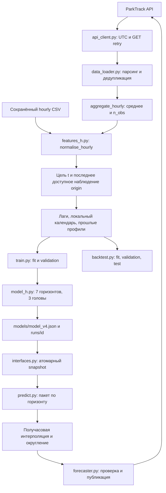

# ParkTrack ML 4.1: устройство, проверка и ограничения

Состояние реализации: 18 ноября 2026 года. Это описание кода и локальных артефактов; версия контейнера на production не проверена. Предыдущий подробный документ с весами v3 сохранён как [архив](https://github.com/BeganovR/SmartParking/blob/feature/parktrack-analysis/analysis/ML_MODEL_FULL.md).

## Что изменено и почему

| Узел | Реализация 4.1 | Ограничение |
|---|---|---|
| Парсинг наблюдений | Некорректные счётчики удаляются; ошибки не превращаются в нулевую загрузку | Детектор всё ещё может прислать ошибочный, но формально допустимый счётчик |
| Дубликаты | Приоритет времени поступления; confidence сравнивается между одинаковыми счётчиками | При отсутствии времени поступления конфликтующие значения нельзя надёжно упорядочить |
| Почасовая история | Среднее по наблюдениям, `n_obs`, confidence только обнаруженных машин | Часовое среднее скрывает кратковременные заполнения |
| Время | Индексы UTC; календарь Москвы; текущий незавершённый час исключён | Последний полностью завершённый час уже немного устарел |
| Лаги | От фактического origin, независимо от выбранного бустера | При возрасте истории больше 72 часов прогноз отклоняется |
| Профили | Только прошлое временного блока; окно 45 дней и отдельный профиль 14 дней | Профиль редкой зоны может отсутствовать; это NaN, а не придуманная норма |
| Выбор модели | Early stopping и температура на validation; сохранение без рефита | Validation использован для подбора, его метрики не являются независимым тестом |
| Загрузка артефактов | Неизменяемая директория, SHA256, атомарное переключение manifest и кеша | Атомарность публикации не означает резервное копирование диска |
| Выпуски прогнозов | Новый `generated_at` на запуск; конфликт считается отдельно | Сохраняются одиночные POST: серверный batch-endpoint не добавлялся |
| Слоты `:30` | Интерполяция соседних часовых прогнозов | Дополнительные реальные наблюдения за полчаса при этом не появляются |

## Источник и происхождение данных

Основной источник — собственный ParkTrack REST API: `/zones` и `/occupancy?view=points`. Прямого подключения к базе нет. История для офлайн-проверки взята из ранее сохранённой выгрузки, не из новой загрузки ноября:

[SmartParking/analysis/data/hourly_clean.csv.gz](https://github.com/BeganovR/SmartParking/blob/feature/parktrack-analysis/analysis/data/hourly_clean.csv.gz)

В ней 172 513 часовых записей по 81 зоне за период с 25 ноября 2025 года по 26 октября 2026 года. Новые внешние датасеты в эту проверку не добавлялись. Сырая прежняя выгрузка содержала 1 882 690 наблюдений; 27,6% повторяли ключ `(zone_id, observed_at)`. Почасовой файл уже очищен, поэтому исправленный парсер нельзя ретроспективно применить к его исходным JSON без повторной загрузки сырой истории.

`TRAIN_DAYS_BACK` ограничивает выгрузку из API. При `--hourly-csv` используется вся история предоставленного файла, без автоматического обрезания до 200 дней; окно статистического профиля при этом остаётся 45 дней.

После 1 октября в этом снимке остаётся только зона 8. Это ограничивает представительность последних дней validation. Пропуски камер не считаются пустыми парковками и не используются как целевые нули.

Для новых выгрузок `aggregate_hourly` также сохраняет `free_fraction`: долю наблюдений часа, в которых оставалось хотя бы одно место. В старом часовом CSV такого столбца нет. Модель 4.1 пока обучается на другом, явно указанном ниже proxy-событии; наличие столбца `free_fraction` само по себе не меняет цель.

## Путь данных по модулям



### Парсинг и агрегация

`occupied` и `capacity` должны быть конечными целыми числами, `occupied >= 0`, `capacity > 0`. Ошибочные строки отбрасываются. Значения `occupied > capacity` ограничиваются вместимостью и логируются; это компромисс очистки, который не исправляет ошибку разметки зоны.

Отсутствующий confidence остаётся неизвестным. У детектора `confidence=0` для пустой зоны допустим: это не вероятность неправильного наблюдения. Поэтому сортировка любых конфликтующих счётчиков только по confidence завышала бы число машин. Новая дедупликация использует доступное время поступления, а confidence — для выбора между одинаковыми счётчиками. Неразрешимые конфликты отмечаются в журнале.

Часовая цель — простое среднее долей занятых мест. `n_obs` отражает число наблюдений; вес часа при обучении `clip(sqrt(n_obs), 1, 8)`. Это снижает влияние редких наблюдений, но число кадров не является доказанной вероятностью качества. Средняя confidence зоны считается по непустым наблюдениям; зоны со значением ниже 0,30 исключаются по данным fit-периода. В текущем снимке это зоны 16, 80 и 82.

### Время и доступность

Часы хранятся как timezone-aware UTC. `_fmt` сначала переводит любое aware-время в UTC и только затем добавляет `Z`. Naive-время по контракту трактуется как UTC.

`hod`, `dow`, выходной, синус/косинус часа и праздник считаются в `Europe/Moscow`. Признак праздника использует существующий календарь проекта; полноценный производственный календарь с переносами не добавлялся.

Инференс отбрасывает текущий незавершённый час и фильтрует историю по запрошенной зоне. Параметр `as_of` фиксирует момент доступности данных. Внешний интерфейс отклоняет исторический `as_of`, если модель обучена позднее или использовала более поздние данные. Для качества в прошлом используется переобучение внутри backtest, а не современный артефакт с подставленной старой датой.

В часовом CSV нет полного журнала времени поступления каждого наблюдения. Поэтому бэктест предполагает, что завершённый час был доступен к моменту выпуска. Возможные поздние загрузки старых наблюдений и фактическую задержку API этот снимок проверить не позволяет.

## 30 признаков и их связи

Пусть `t` — целевой час UTC, `o` — последний реально наблюдавшийся завершённый час, `g = (t-o)` в часах. Модель выбирается как минимальный `H >= g` из `[1, 3, 6, 12, 24, 48, 72]`. При `g < 1` или `g > 72` запрос отклоняется. Выбор `H=6` не заменяет свежий origin на `t-6`.

| Порядок | Признак | Значение |
|---|---|---|
| 1–4 | `last`, `last1`, `last2`, `last3` | `y(o)`, `y(o-1)`, `y(o-2)`, `y(o-3)` |
| 5 | `ma4` | Среднее доступных четырёх последних лагов |
| 6–8 | `lag_day`, `lag_day2`, `lag_day3` | `y(t-D)`, `y(t-D-24)`, `y(t-D-48)`, где `D=24*ceil(g/24)` |
| 9 | `lag_week` | `y(t-168)` |
| 10–15 | `hod`, `dow`, `is_weekend`, `hour_sin`, `hour_cos`, `is_holiday` | Локальный календарь целевого часа |
| 16 | `prof` | Прошлый профиль зоны по дню недели и часу цели |
| 17 | `prof_hod` | Прошлый профиль зоны по часу цели |
| 18 | `zone_mean` | Средняя загрузка зоны в окне профиля |
| 19 | `prof_14d_hod` | Профиль часа цели по последним 14 дням |
| 20 | `prof_last_hod` | Профиль зоны по локальному часу origin |
| 21–22 | `diff_1h`, `diff_3h` | `last-last1`, `last-last3` |
| 23 | `anomaly_vs_prof` | `last-prof_last_hod` |
| 24–25 | `rolling_mean_24h`, `rolling_max_24h` | Среднее и максимум на сетке `[o-23h, o]` |
| 26 | `lag_coverage` | Доля доступных значений среди восьми исходных лагов |
| 27 | `exact_gap` | Фактический `g`, а не верхняя граница bucket |
| 28 | `zone_id` | Категориальный код зоны в LightGBM |
| 29 | `capacity` | Вместимость последнего наблюдения, доступного на origin |
| 30 | `zone_type_standard` | Тип зоны; при отсутствии известного типа используется 1 |

На почасовой сетке выполняется только causal `ffill(limit=2)`: прошлое наблюдение может заполнить следующие два пропуска. Более длинный разрыв остаётся NaN. Заполняется история признаков, реальные targets не синтезируются. Отсутствующие числовые признаки обрабатывает LightGBM.

Для обучения внутри bucket используются нижний, средний и верхний допустимые целочисленные gaps; дубли одинаковых `(zone, target, origin)` убираются. Один target может иметь несколько origin — это разные прогнозные задачи, а не дубликаты измерений. Метрики агрегируются по этим задачам, поэтому это не буквально по одному прогнозу на каждый час.

### Профили без будущего

Обучающие строки объединяются по семидневным блокам времени origin. Для блока профиль считается только по исходным часам **до начала блока**, максимум за 45 дней. Первые строки могут иметь неизвестный профиль; будущие недели не подмешиваются. Это устраняет прежнюю схему `ISO_week % 4`.

Для validation и test профиль один и заморожен на fit-срезе. Фильтр ненадёжных зон и сохраняемые метаданные также определяются только по fit. Признак вместимости берётся из доступной истории на origin, поэтому изменение вместимости уже после обучения учитывается без знания будущих targets. Предстоящая смена вместимости остаётся неизвестной модели.

## Модели, параметры и выходы

Для каждого H сохраняются:

1. `cls`: multiclass, классы Low `<0.33`, Medium `[0.33,0.67)`, High `>=0.67`.
2. `reg`: L2-регрессия доли занятости, результат ограничивается `[0,1]`.
3. `free`: бинарная классификация события `rate < (capacity-0.5)/capacity`.

Общие параметры: learning rate 0,05; num_leaves 31; min_child_samples 50; subsample 0,8 с subsample_freq 1; colsample_bytree 0,8; L1/L2-регуляризация 0,1/0,1; seed 42. Категориальные параметры: min_data_per_group 50, cat_smooth 20. Регрессор переопределяет num_leaves=63, min_child_samples=20, max_depth=8. До 1000 итераций, early stopping после 50 без улучшения. По умолчанию 4 потока, задаются `LGBM_THREADS`.

Для каждого дерева вход проходит по условиям признаков до листа. Значение `leaf_value` выбранного листа добавляется к сумме головы. У reg сумма даёт долю загрузки перед ограничением `[0,1]`; у cls есть три суммы, по одной на класс, и softmax переводит их в вероятности; у free сумма превращается в вероятность бинарным sigmoid. В сериализованных `leaf_value` уже учтены вклад начального прогноза и shrinkage: повторно умножать их на learning rate при чтении весов нельзя. Числовой код `zone_id` участвует в категориальных разбиениях, а не означает расстояние между зонами.

Увеличение дерева не гарантирует восстановления амплитуды. L2 оценивает условное среднее; при неопределённости сглаживание может быть правильным. Смотрим MAE, ошибки в пиковые часы и сравнение с baseline, а не растягиваем результат до 0–100% вручную.

Для `cls` температура выбирается по log-loss на сетке от 0,6 до 3,0 с шагом 0,05. Формула: `p_cal = softmax(log(p)/T)`. На validation выбираются и число деревьев, и температура. Сохраняется тот же бустер; старую температуру на переобученную модель не переносим. Отдельного независимого calibration-периода здесь нет.

В `train.py` хвост validation равен минимуму из 14 дней и 20% длительности истории. `backtest.py` использует фиксированные 14 дней перед split. Early stopping использует веса `n_obs`; температура и показанные итоговые метрики считаются без этих весов.

### Что получает API

`predicted_occupied = round(rate_hat*capacity)`, с ограничением `[0,capacity]`. Возвращаемый `occupancy_class` определяется по доле после этого округления. Это делает класс согласованным с целым счётчиком, но особенно на маленьких парковках округление меняет класс.

`prob_low`, `prob_medium`, `prob_high` — температурно скорректированные вероятности отдельного `cls`. Они не подгоняются под регрессор; argmax может отличаться от возвращённого класса. `confidence` — вероятность выбранного через регрессор класса. Поэтому в бэктесте отдельно оцениваются classifier и публичный regression-class.

`probability_free_space` больше не равна `1-P(High)`. Однако новая бинарная цель вычисляется из **средней загрузки часа**, а не из состояния парковки в момент приезда. Голова пока не калибрована отдельно. Название поля оставлено ради совместимости API; metadata явно указывает proxy-семантику. Нельзя обещать водителю «вероятность свободного места» без проверки на подходящих минутных целях и отдельной калибровки.

Слоты `:30` получают линейную интерполяцию `rate_hat`, трёх вероятностей и binary probability между часовыми anchors. Затем заново вычисляются счётчик и класс. Это устраняет дублирующиеся вызовы и грубые ступеньки, но само по себе не повышает точность минутного прогноза.

## Честная оценка

`backtest.py --split D` задаёт:

- fit: target раньше `D-14 дней`;
- validation: target от `D-14 дней` до D, origin не раньше начала validation;
- test: target от D, origin не раньше D.

Это purge на границах: в validation/test не остаются прогнозы, которые должны были быть выпущены до готовности соответствующей модели. При нескольких `--split` тестовый период первого fold заканчивается на следующем split. Затем модель обучается заново на увеличенном прошлом; следующий test содержит другой временной отрезок.

Сравнения: persistence, замороженный профиль, неделя назад и always-Low. Отчёт показывает весь поток, доступность каждого baseline и общую выборку, где доступны все три. Ошибки разных алгоритмов нельзя сравнивать по разным наборам строк.

Есть MAE по доле, accuracy classifier и публичного regression-class, recall каждого класса, log-loss/Brier вероятностей, таблицы калибровки и ECE. Для binary головы Brier относится только к proxy-событию. Квантили p05/p95 факта и прогноза описывают их распределения; это не доверительные интервалы.

Повторение тестовых проверок после выбора параметров превращает эти периоды в исследовательские. Для финального продуктового обещания нужен новый, ранее не просмотренный период с живым сбором данных.

### Результат двух исторических проверок

Локально сохранены 1 470 496 прогнозных задач по 77 зонам в `analysis/data/backtest_v41.csv.gz`. Файл содержит origin, фактический gap, ответы всех голов, targets и baseline. Это число задач по разным gaps, не число независимых новых наблюдений. Выгрузка занимает около 98 МБ и не включена в Git; команда её воспроизведения приведена ниже.

Первый fold: split 1 июля, фактический test 1 июля–7 августа, 924 767 задач, 77 зон. Общая выборка baseline покрывает 92,5% задач. Второй: split 15 августа, но из-за пропуска сбора test фактически начинается **11 сентября** и заканчивается 26 октября; 545 729 задач, 73 зоны, покрытие общей выборки 64,8%. Поэтому второй fold дополнительно проверяет перенос модели через длительный разрыв данных. Внутри каждого test веса и профили не переобучаются ежедневно; это не точная симуляция ежедневного production-retrain.

В таблицах accuracy дана в процентах на одинаковых общих строках. `Класс API` определяется регрессором после округления; `cls` — argmax отдельного классификатора. MAE — средняя абсолютная ошибка доли загрузки в процентных пунктах. Лучший baseline выбирается отдельно для accuracy и MAE из persistence, профиля и недели назад; это не всегда один алгоритм.

| Split | H | Класс API, % | cls, % | Лучший baseline, % | MAE модели, п.п. | MAE лучшего baseline, п.п. |
|---|---:|---:|---:|---:|---:|---:|
| 01.07 | 1 | 84,0 | 84,6 | 81,7 | 8,07 | 8,72 |
| 01.07 | 3 | 79,2 | 80,6 | 72,1 | 10,51 | 14,33 |
| 01.07 | 6 | 76,6 | 78,5 | 72,1 | 12,02 | 14,35 |
| 01.07 | 12 | 74,7 | 77,0 | 71,9 | 12,89 | 14,39 |
| 01.07 | 24 | 74,3 | 76,8 | 71,8 | 13,00 | 14,38 |
| 01.07 | 48 | 73,8 | 76,0 | 72,2 | 13,37 | 14,22 |
| 01.07 | 72 | 72,9 | 75,8 | 72,3 | 13,86 | 14,17 |
| 15.08 | 1 | 84,4 | 85,3 | 82,2 | 7,73 | 8,57 |
| 15.08 | 3 | 79,5 | 81,0 | 75,1 | 10,36 | 13,31 |
| 15.08 | 6 | 77,5 | 78,2 | 75,1 | 11,67 | 13,32 |
| 15.08 | 12 | 76,1 | 76,6 | 75,2 | 12,43 | 13,26 |
| 15.08 | 24 | 75,3 | 76,3 | 75,5 | 12,78 | 13,12 |
| 15.08 | 48 | 73,7 | 75,1 | 75,3 | 13,58 | 13,22 |
| 15.08 | 72 | 73,1 | 74,8 | 75,3 | 13,73 | 13,25 |

**Критерий «уверенно лучше всех baseline на всех горизонтах» не выполнен.** Во втором fold H=48/72 хуже недели назад по MAE и accuracy класса API, H=24 лучше по MAE, но немного хуже по accuracy. Менять гиперпараметры до победы на уже просмотренном test и затем называть его независимым было бы некорректно. Выкладка этим бэктестом не одобрена; новый комплект оставлен локально для исследования.

У reg-класса ECE первого fold составляет 1,3–2,1 п.п., второго — 1,0–3,8 п.п. На H=48/72 второго fold вероятности заметно переоценивают точность в части диапазона confidence; калибровка на старом validation не гарантирует калибровку после смены режима.

### Проверка амплитуды

Прогнозы не зажаты глобально в 26–53%. Во втором fold p05/p95 всего потока равны примерно 0–93% для H=1 и 2–86% для H=72. Но общие квантили могут скрыть сглаживание конкретной зоны.

Поэтому отдельно выбраны зоны с минимум 100 задачами, фактическим p05 <15% и p95 >80%. Во втором fold таких зон 44. Медианные по зонам p05/p95 прогноза: H=1 — 0,6–91,2%, H=24 — 5,1–81,9%, H=72 — 6,0–77,4%; медианные фактические границы — 0–100%. Сглаживание дальнего горизонта остаётся. Эти квантили описывают весь test-период, не доказывают нужную амплитуду каждого дня и не являются тестом графика за 17 ноября.

### Проверка реализации

104 unit-теста прошли; компиляция всех Python-модулей и `git diff --check` прошли. Проверены причинность заполнения пропусков, паритет train/inference, разрешения datetime ns/us/ms, локальный календарь и UTC-сериализация, смена вместимости, границы fit/val/test, сохранение/повреждение/переключение артефактов, retry и счётчики публикации.

Реальный сохранённый комплект загружен через публичный интерфейс: проверены сумма вероятностей, соответствие класса и счётчика, получасовые запросы, неизвестная зона и отклонение устаревшей истории. Для этого smoke-теста timestamps старой истории сдвинуты к текущему времени; это техническая проверка, не оценка точности. Сверены SHA256 всех весов и исходников с manifest.

APScheduler 3.11.3 установлен только во временное окружение. Проверены настоящий импорт сервиса и регистрация четырёх задач без запуска сетевых функций; следующее переобучение назначается на 02:00 UTC. Живой планировщик с публикацией в API, Docker-сборка, текущий production-контейнер и график за 17 ноября не проверялись. POST в live API и deployment не выполнялись. Для применения к работающему сервису потребуется отдельно обновить его код/артефакты и перезапустить.

Дополнительно предпринят read-only GET прогнозов зоны 8 за 17 ноября через настроенный API. Он завершился `SSLError` до получения HTTP-ответа; проверку сертификата не отключали. Поэтому текущие `model_version/generated_at` из production не установлены. Сам тип ошибки не позволяет без отдельной диагностики заключить, проблема на сервере или в локальном доверии сертификатам.

## Артефакты, веса и воспроизводимость

`models/model_v4.json` содержит текущий полный manifest. Поле `artifact_dir` указывает на `models/runs/<uuid>/`, где находятся архивный `manifest.json` и 21 текстовый `.lgb`. В каждом `.lgb` записаны параметры, все деревья, условия разбиений и `leaf_value`; это фактические веса модели. JSON содержит порядок признаков, температуры, профили, известные зоны, временные границы, метрики подбора, версии Python/пакетов, хеши исходников, отпечаток входной таблицы и SHA256 бустеров.

Сохранение сначала полностью пишет staging-директорию, затем переименовывает её в окончательный UUID и атомарно заменяет JSON-указатель. Загрузчик проверяет хеши и совместимость признаков. `interfaces.py` собирает новый snapshot под lock и только после успешной загрузки переключает кеш. Уже начавшийся прогноз может закончить работу на старом полном snapshot; смешанный набор старых/новых голов не загружается. Старые UUID автоматически не удаляются.

Наличие артефактов не означает их выкладку на сервер. Старая сериализация LightGBM может иметь заголовок `version=v4` — это версия формата файла, не версия ParkTrack ML.

### Сохранённый локальный комплект 18 ноября

Локальный указатель: `models/model_v4.json`. Неизменяемый manifest: `models/runs/fa77385a9daa4fd581d08cddfa65b475/manifest.json`. Общий объём бустеров — 32 682 483 байта. Веса игнорируются Git; ниже имена файлов в той же директории, создаваемых командой обучения:

| H, ч | Итерации cls / reg / free | Полные веса |
|---|---|---|
| 1 | 331 / 393 / 203 | `v4_h1_cls.lgb`, `v4_h1_reg.lgb`, `v4_h1_free.lgb` |
| 3 | 288 / 154 / 491 | `v4_h3_cls.lgb`, `v4_h3_reg.lgb`, `v4_h3_free.lgb` |
| 6 | 213 / 86 / 181 | `v4_h6_cls.lgb`, `v4_h6_reg.lgb`, `v4_h6_free.lgb` |
| 12 | 295 / 67 / 293 | `v4_h12_cls.lgb`, `v4_h12_reg.lgb`, `v4_h12_free.lgb` |
| 24 | 214 / 65 / 202 | `v4_h24_cls.lgb`, `v4_h24_reg.lgb`, `v4_h24_free.lgb` |
| 48 | 284 / 71 / 323 | `v4_h48_cls.lgb`, `v4_h48_reg.lgb`, `v4_h48_free.lgb` |
| 72 | 135 / 75 / 257 | `v4_h72_cls.lgb`, `v4_h72_reg.lgb`, `v4_h72_free.lgb` |

Для multiclass число деревьев втрое больше числа итераций; у reg/free — по одному дереву на итерацию. Конкретные параметры каждого бустера и выбранные итерации также сохранены в `training_config` manifest. Fit заканчивается 12 октября в 09:00 UTC; validation начинается в 10:00 UTC и использует данные до 26 октября 10:00 UTC. В validation присутствует только одна зона. Артефакты игнорируются Git; для передачи модели другой машине требуется передать весь комплект, а не один JSON-указатель.

## Публикация и проверка гипотезы HTTP 409

Проверенный контракт Python-бэкенда: уникальность `(zone_id, generated_at, predicted_for)`, а не `(zone_id, predicted_for)`. Другая дата выпуска создаёт новую версию. Поэтому гипотеза «первый прогноз за 48 часов навсегда блокирует уточнения» не подтверждается.

Источники: [миграция unique key](https://github.com/ParkTrack-Project/api-server/blob/f35a1eec9f9f221ae3f61a052bc161726da452ad/migrations/000009_create_forecasts.up.sql#L18), [обработка создания](https://github.com/ParkTrack-Project/api-server/blob/f35a1eec9f9f221ae3f61a052bc161726da452ad/src/routers/forecasts.py#L571), [выбор прогноза картой](https://github.com/ParkTrack-Project/api-server/blob/f35a1eec9f9f221ae3f61a052bc161726da452ad/src/routers/forecasts.py#L347).

Историческая таблица `forecast_vs_actual.csv.gz` тоже содержит несколько выпусков для 12 423 из 12 667 пар `(zone_id, target_hour)`, максимум 48 выпусков. Это не проверяет текущий контейнер ноября, но опровергает общее предположение об одной навсегда фиксированной записи.

GET карты сначала выбирает ближайший `predicted_for`, затем самый новый `generated_at`. Точный старый слот и более новый соседний слот поэтому требуют отдельного разбора параметров запроса. В web-map фильтр последней модели не включён. Роут PUT по forecast_id существует, но менять им версионированную историю для исправления предполагаемого 409 не требуется. SQL именно графика за 17 ноября и production-логи не проверены.

Каждый запуск forecaster использует единый `generated_at/as_of`, 96 будущих получасовых слотов при 48 часах, до четырёх рабочих потоков. Вычисления группируются по зоне и горизонту; один HTTP POST на слот пока остаётся. У каждого публикующего потока отдельный клиент. Перед первым POST проверяется весь пакет зоны. Отдельно считаются созданные записи, конфликты, ошибки POST, истории и предсказаний.

GET повторяется до трёх попыток с backoff при сетевых сбоях, 429 и 5xx. POST автоматически не повторяется. При отсутствии корректной истории публикация зоны пропускается с ERROR. Погода не участвует в текущих 30 признаках; её историческая загрузка вынесена из синхронного старта сервиса.

## Запуск и оставшиеся задачи

```bash
python -m unittest discover -s tests -q
python -m parktrack_ml.backtest --hourly-csv /path/to/hourly_clean.csv.gz --split 2026-07-01 2026-08-15 --output /path/to/backtest_v41.csv.gz
python -m parktrack_ml.train --hourly-csv /path/to/hourly_clean.csv.gz
```

Для production нужны свежая сырая выгрузка, проверка живого сбора по зонам, проверка версии контейнера и времени выпуска отображаемых прогнозов. Старый hourly-файл заканчивается октябрём и не годится как свежая история для сервиса в ноябре. Нужно отдельно оценить ошибки по зонам/пиковым часам, изменение вместимости, неизвестные зоны и реальную доступность места на момент приезда. Погода, события, переносы рабочих дней и пространственные признаки пока не добавлены.
